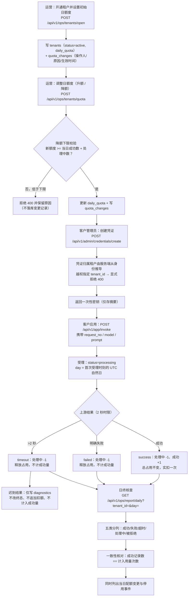
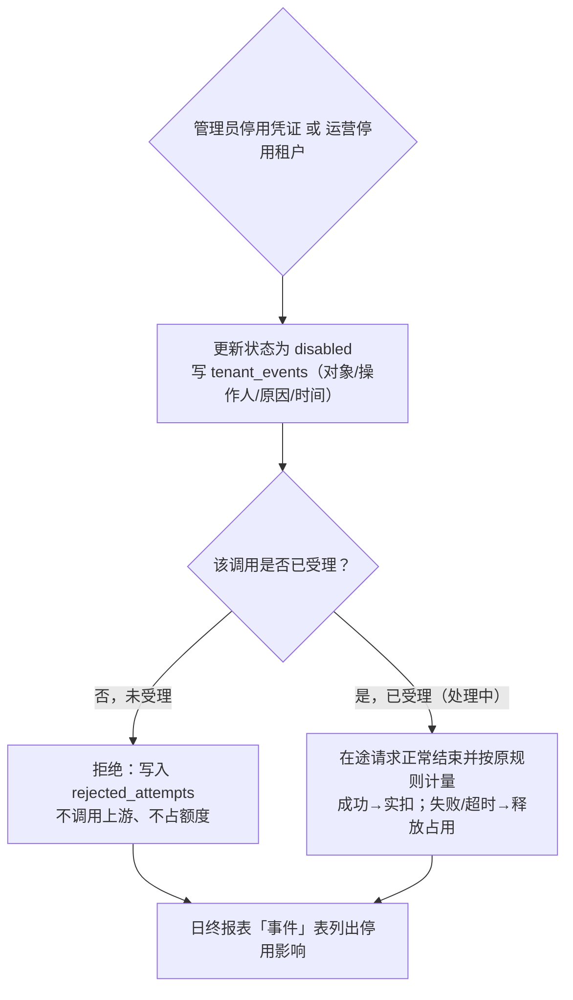

# 题目 05 原型设计：企业模型服务配额管理工作台

> 本文为过程文档，描述设计与计划，不代表执行结果；执行证据见 evidence/ 目录。

- 题面来源：`docs/_question-05.md`；共同要求：`docs/_common-requirements.md`。
- 上游依据：`docs/01-需求分析.md`（R1–R8 规则、A1–A13 假设、Q1–Q12 确认结论）。
- 原型形态：**服务端渲染的真实页面**（Go `html/template`），而非静态线框稿。
  原型与实现的唯一事实来源是 `internal/httpapi/web/templates/` 下的模板文件，
  本文的区块、字段、列名与按钮均按模板原文抄录，未做美化或增补。
- 页面入口：`internal/httpapi/server.go` 的 `routes()`；模板装配：`internal/httpapi/pages.go` 的 `LoadTemplates()`。
- 图形版：本文是原型的**文字版**；原型的**图形版**为 8 张静态线框图（4 页 × 正常态/异常态），
  位于 `docs/原型线框图/`，由 `scripts/gen-prototype-svg.py` **从上述模板派生**并在图上标注来源行号，
  索引见 `docs/16-原型线框图索引.md`。SVG 只是同源静态副本，**不是原型本体**；
  两者不一致时以模板与运行实例为准（`AGENTS.md` §8 第 7 条）。
- 引用约定：文中「文件:行号」是撰写时的仓库快照，后续代码调整可能导致行号漂移；**函数名、字段名、模板区块标题才是稳定锚点**，核对时以符号名为准。

---

## 1. 原型设计原则

| # | 原则 | 落地方式 | 落点 |
|---|---|---|---|
| P1 | 每个页面只服务一个角色 | `/ops` 仅运营、`/admin` 仅客户管理员、`/app` 仅应用凭证；越权访问 303 跳回 `/` | `internal/httpapi/pages.go:205`、`:301`、`:356` |
| P2 | 页面即可操作，不要求手工拼 JSON | 表单提交 `application/x-www-form-urlencoded`，与 JSON 接口共用同一业务逻辑 | `internal/httpapi/decode.go:38` |
| P3 | 异常与失败原因必须可见 | 4xx 错误回显在页面顶部红色提示区；成功回显在绿色提示区 | `internal/httpapi/decode.go:166`、模板 `internal/httpapi/web/templates/layout.html:50-51` |
| P4 | 密钥类敏感信息只出现一次 | 创建凭证后直接渲染一次含密钥页面，不重定向、不落库明文 | `internal/httpapi/pages.go:322` |
| P5 | 核查口径在页面上自解释 | 每个区块附题面规则编号说明（R1/R2/R4/R5/R7/R8） | `internal/httpapi/web/templates/ops.html:14`、`internal/httpapi/web/templates/admin.html:14`、`internal/httpapi/web/templates/app.html:15` |
| P6 | 演示可重复 | 上游场景由页面下拉框选择，不依赖外部状态 | `internal/httpapi/web/templates/app.html:22-29` |

---

## 2. 全局布局（`internal/httpapi/web/templates/layout.html`）

所有页面共用 `internal/httpapi/web/templates/layout.html`，页面模板只 `define "content"` 注入内容区
（约定见 `AGENTS.md` §6.6）。

```
+----------------------------------------------------------------------------------+
| 企业模型服务配额管理        运营台 | 租户管理台 | 应用调用台      admin-a（tenant_admin / 租户 tenant-a） · 2026-11-11 20:14:03 UTC |
+----------------------------------------------------------------------------------+
|  <红色提示区 .err>   ← 仅当 ?error= 存在时出现（4xx 及可纠正错误）                  |
|  <绿色提示区 .msg>   ← 仅当 ?message= 存在时出现（操作成功）                        |
+----------------------------------------------------------------------------------+
|                                                                                  |
|                        {{template "content" .}}   ← 各页面内容区                   |
|                                                                                  |
+----------------------------------------------------------------------------------+
```

- 顶栏右侧显示当前身份：`用户名（角色 / 租户 X）`；运营的租户位置显示「全局」；未登录显示「未登录」（`internal/httpapi/web/templates/layout.html:45-47`）。
- 导航三个工作台链接对所有登录用户恒显，但页面级角色校验在服务端完成，点击后按角色重定向或退回 `/`。
- 未登录访问任一工作台 → 303 跳 `/login`（`internal/httpapi/pages.go:132-139`）。
- 访问 `/` → 按身份分别 303 跳 `/ops`、`/admin`、`/app`（`internal/httpapi/pages.go:164-171`）；未知路径 → 404 页面（`internal/httpapi/web/templates/notfound.html`）。

---

## 3. 登录页 `/login`（`internal/httpapi/web/templates/login.html`）

平台运营与客户管理员用**预置账号口令**登录；客户应用用**凭证密钥**登录。身份与租户归属由服务端签发，请求参数无法指定。

```
+----------------------------------------------------------------------------------+
| 登录                                                                            |
|   平台运营与租户管理员使用预置账号口令登录；客户应用使用凭证密钥登录。            |
|   身份与租户归属由服务端签发，请求参数无法指定。                                  |
|                                                                                  |
|   [kind=admin(隐藏)]  用户名 [ops / admin-a / admin-b ]  口令 [●●●●●●]  (管理员登录)|
|   [kind=credential(隐藏)]  凭证密钥 [ sk_...            ]                  (应用登录)|
+----------------------------------------------------------------------------------+
| 预置账号                                                                          |
| | 账号     | 角色       | 租户      | 口令     |                                |
| | ops      | 平台运营   | 全局      | ••••••  |                                |
| | admin-a  | 客户管理员 | tenant-a  | ••••••  |                                |
| | admin-b  | 客户管理员 | tenant-b  | ••••••  |                                |
| 口令不在页面上明文展示，初始口令见 docs/04-部署与使用说明.md；首次登录后请在真实环  |
| 境中替换。登录接口为 JSON 接口（POST /api/v1/auth/login），本页表单仅用于浏览器演示。|
+----------------------------------------------------------------------------------+
```

| 区块 | 字段 / 元素 | 提交目标 | 说明 |
|---|---|---|---|
| 登录 | 隐藏域 `kind=admin`；`username`；`password`（`type=password`）；按钮「管理员登录」 | `POST /api/v1/auth/login` | 账号口令登录 |
| 登录 | 隐藏域 `kind=credential`；`secret`；按钮「应用登录」 | `POST /api/v1/auth/login` | 凭证密钥登录 |
| 预置账号 | 表格列：账号 / 角色 / 租户 / 口令 | — | 口令脱敏展示（`login.html:21-23`） |

说明：隐藏域 `kind` 在表单解码时被忽略（`internal/httpapi/decode.go:56-58`），真正的分流依据是请求体中是否带 `secret`。

---

## 4. 平台运营工作台 `/ops`（`internal/httpapi/web/templates/ops.html`）

面向**平台运营**：开通/停用租户、调整配额、跨租户日终核查、查看迟到诊断。运营没有租户归属，跨租户核查由服务端在页面装配时逐租户展开（`internal/httpapi/pages.go:217-231`）。

```
+----------------------------------------------------------------------------------+
| 核查日期                                                                          |
|  UTC 自然日 [2026-11-11 (date)] [查看该日核查]  缺省为 UTC 今日（2026-11-11）。     |
|  当前服务时间：2026-11-11 20:14:03 UTC                                            |
+----------------------------------------------------------------------------------+
| 租户与配额                                                                        |
|  配额是租户级属性，租户下所有凭证共享同一份日额度（题面 R2）。                     |
|  降低额度不得低于当日已成功数量加处理中数量（R5）。                                |
| | 租户       | 名称                    | 状态   | 日额度 | 操作                  |
| | tenant-a   | 企业甲（演示活动客户）  | 已开通 | 10     | [10] [变更原因(必填)] [调整额度]   |
| |            |                         |        |        |        [停用原因(必填)] [停用租户] |
| | tenant-b   | 企业乙（凭证泄露客户）  | 已开通 | 10     | [10] [变更原因(必填)] [调整额度]   |
| |            |                         |        |        |        [停用原因(必填)] [停用租户] |
|                                                                                  |
|  [新租户名称] [日额度=10] [开通原因] [开通租户]                                   |
+----------------------------------------------------------------------------------+
| 日终核查（2026-11-11）                                                            |
|  按租户与日期分列成功、失败、超时、处理中与被拒绝请求，并核对                       |
|  「成功记录数 == 计入用量次数」（题面 R8）。                                        |
| | 租户     | 成功 | 失败 | 超时 | 处理中 | 被拒绝 | 额度 | 剩余 | 一致性   |
| | tenant-a |  10  |  0   |  0   |   0    |   2    |  10  |  0   | 一致    |
| | tenant-b |   0  |  0   |  0   |   0    |   0    |  10  | 10   | 一致    |
+----------------------------------------------------------------------------------+
| 配额变更与停用影响                                                                |
| | 租户     | 变更      | 操作人 | 原因     | 生效时间             |
| | tenant-a | 0 → 10    | ops    | 预置...  | 2026-11-11 19:02:11  |
| | 租户     | 事件              | 操作人 | 原因 | 说明        | 时间                |
| | tenant-a | tenant_disabled    | ops    | 冒烟 | 停用租户.. | 2026-11-11 19:05:02 |
+----------------------------------------------------------------------------------+
| 诊断记录（迟到结果）                                                              |
|  迟到结果只作诊断保留，不改变请求终态、不追加扣额、不计入成功量（题面 R4）。        |
| | 租户     | 类型        | 详情                       | 记录时间             |
| | tenant-a | late_result | 迟到结果（上游在超时后返回）| 2026-11-11 19:04:10  |
| （无数据时单行占位：暂无诊断记录）                                                |
+----------------------------------------------------------------------------------+
```

| 区块 | 表格列 / 表单字段 | 操作入口（method + path） |
|---|---|---|
| 核查日期 | `day`（`<input type="date">`，必填） | `GET /ops?day=YYYY-MM-DD` |
| 租户与配额 | 表列：租户 / 名称 / 状态 / 日额度 / 操作 | — |
| ↳ 调整额度 | `tenant_id`（隐藏）、`daily_quota`（number，0–100000）、`reason`（必填） | `POST /api/v1/ops/tenants/quota` |
| ↳ 停用租户 | `tenant_id`（隐藏）、`reason`（必填） | `POST /api/v1/ops/tenants/disable` |
| ↳ 开通租户 | `name`（必填）、`daily_quota`（number，默认 10，0–100000）、`reason` | `POST /api/v1/ops/tenants/open` |
| 日终核查 | 表列：租户 / 成功 / 失败 / 超时 / 处理中 / 被拒绝 / 额度 / 剩余 / 一致性 | 数据源 `GET /api/v1/ops/report/daily` |
| 配额变更与停用影响 | 表 1 列：租户 / 变更 / 操作人 / 原因 / 生效时间；表 2 列：租户 / 事件 / 操作人 / 原因 / 说明 / 时间 | 数据源同上报表的 `quota_changes` / `events` |
| 诊断记录 | 表列：租户 / 类型 / 详情 / 记录时间 | 数据源 `GET /api/v1/ops/diagnostics` |

> 模板中「成功/失败/超时/处理中/被拒绝」五列通过 `DailyReport.CountOf` 取值，
> 而非直接用字符串下标访问 `map[RequestStatus]int`（约定见 `AGENTS.md` §6.6）。

---

## 5. 租户管理台 `/admin`（`internal/httpapi/web/templates/admin.html`）

面向**客户管理员**：管理**本租户**的凭证、查看**本租户**全部调用与用量。凭证所属租户由服务端从登录身份推导，创建凭证时不能指定其他租户。

```
+----------------------------------------------------------------------------------+
| 核查日期                                                                          |
|  UTC 自然日 [2026-11-11 (date)] [查看该日记录]  缺省为 UTC 今日（2026-11-11）。    |
+----------------------------------------------------------------------------------+
| 租户概况                                                                          |
|  管理员可查看本租户全部调用、成功量、处理中量和剩余额度（R7）。                    |
|  凭证所属租户由系统确认，创建凭证时不能指定其他租户（R1）。                        |
|   [10  日额度] [10  成功量] [0  处理中] [0  剩余额度] [tenant-a  租户编号]         |
+----------------------------------------------------------------------------------+
| 应用凭证                                                                          |
|  每个租户最多 2 个凭证（R1 与题面预置条件）。密钥只在创建时返回一次，请立即交给应用。|
|  <绿色提示区> 凭证 app-1 的密钥：sk_********（原型示意；真实密钥由系统随机生成，仅显示一次）|
| | 凭证     | 名称  | 状态 | 创建人 | 停用时间 | 停用原因 | 操作                   |
| | cred_xxx | app-1 | 可用 | admin-a | —       | —        | [停用原因(必填)] [停用凭证] |
| | cred_yyy | app-2 | 已停用 | admin-a | 2026-.. | 凭证泄露 | （无操作）             |
|  [凭证名称 如 app-1] [创建凭证]                                                   |
+----------------------------------------------------------------------------------+
| 本租户调用记录（2026-11-11）                                                      |
| | 请求编号 | 凭证     | 状态   | 模型   | 提示词 | 结果/失败原因 | 幂等命中 | 受理时间 |
| | req_001  | cred_xxx | 成功   | text-1 | 你好   | 模拟模型输出… |    0     | 20:01:11 |
| | req_002  | cred_yyy | 超时   | text-1 | 你好   | 上游调用超过 2 秒，判为超时 | 0 | 20:01:12 |
| 被拒绝的调用尝试                                                                  |
| | 请求编号 | 状态   | 原因                | 发起方 | 时间     |
| | req_003  | 被拒绝 | 当日额度已用尽       | credential:cred_x | 20:01:13 |
| 被拒绝的尝试不占用请求编号，因此额度提升后应用仍可用同一编号重试（确认结论 Q7）。    |
+----------------------------------------------------------------------------------+
```

| 区块 | 表格列 / 表单字段 | 操作入口 |
|---|---|---|
| 核查日期 | `day`（`<input type="date">`，必填） | `GET /admin?day=YYYY-MM-DD` |
| 租户概况 | KPI：日额度 / 成功量 / 处理中 / 剩余额度 / 租户编号 | 数据源 `GET /api/v1/admin/usage` |
| 应用凭证 | 表列：凭证 / 名称 / 状态 / 创建人 / 停用时间 / 停用原因 / 操作 | 数据源 `GET /api/v1/admin/credentials` |
| ↳ 停用凭证 | `credential_id`（隐藏）、`reason`（必填）；**仅 `status=active` 时渲染该按钮** | `POST /api/v1/admin/credentials/disable` |
| ↳ 创建凭证 | `name`（必填） | `POST /api/v1/admin/credentials/create` |
| 本租户调用记录 | 表列：请求编号 / 凭证 / 状态 / 模型 / 提示词 / 结果/失败原因 / 幂等命中 / 受理时间 | 数据源 `GET /api/v1/admin/requests` |
| 被拒绝的调用尝试 | 表列：请求编号 / 状态 / 原因 / 发起方 / 时间 | 同上（响应中的 `rejected`） |

一次性密钥区仅在「刚创建成功」的那一次渲染中出现（`admin.html:25-30`）；刷新页面后不再显示（`internal/httpapi/pages.go:322-336`）。

---

## 6. 应用调用台 `/app`（`internal/httpapi/web/templates/app.html`）

面向**客户应用**（以凭证密钥登录）：发起调用、查询**本凭证创建**的请求。看不到其他凭证或其他租户的数据。

```
+----------------------------------------------------------------------------------+
| 核查日期                                                                          |
|  UTC 自然日 [2026-11-11 (date)] [查看该日记录]  缺省为 UTC 今日（2026-11-11）。    |
+----------------------------------------------------------------------------------+
| 发起模型调用                                                                      |
|  请求必须携带本租户全局唯一编号；相同编号与相同参数重复提交不会再次调用上游、      |
|  也不会重复计量（R3）。同一编号改用不同参数会被拒绝。                              |
|  上游超过 2 秒按超时处理并归还额度（R4）。                                          |
|  [请求编号 如 req-001] [模型 text-1] [提示词 你好]                                |
|  [上游场景 ▼ 成功 | 上游明确失败 | 上游超时(>2 秒) | 重复通知]  [发起调用]       |
|  调用接口为 JSON 接口（POST /api/v1/app/invoke），本页表单仅用于浏览器演示。        |
+----------------------------------------------------------------------------------+
| 本凭证的调用记录（2026-11-11）                                                    |
|  应用仅可查询由本凭证创建的请求（R7），看不到其他凭证或其他租户的数据。            |
| | 请求编号 | 状态 | 模型   | 提示词 | 结果/失败原因 | 幂等命中 | 受理时间 | 完成时间 |
| | req_001  | 成功 | text-1 | 你好   | 模拟模型输出… |    0     | 20:01:11 | 20:01:11 |
| | req_002  | 处理中 | text-1 | 你好 | —             |    0     | 20:01:12 | —        |
+----------------------------------------------------------------------------------+
```

| 区块 | 表格列 / 表单字段 | 操作入口 |
|---|---|---|
| 核查日期 | `day`（`<input type="date">`，必填） | `GET /app?day=YYYY-MM-DD` |
| 发起模型调用 | `request_no`（必填）、`model`（默认 `text-1`）、`prompt`（必填）、`scenario`（下拉：成功 / 上游明确失败 / 上游超时(>2 秒) / 重复通知） | `POST /api/v1/app/invoke` |
| 本凭证的调用记录 | 表列：请求编号 / 状态 / 模型 / 提示词 / 结果/失败原因 / 幂等命中 / 受理时间 / 完成时间 | 数据源 `GET /api/v1/app/requests` |

> 模拟上游另支持 `slow_success`（延迟 3 秒返回，用于观察超时后仍可能完成的在途请求），
> 该场景未在页面下拉框中暴露，需通过 JSON 接口的 `params.scenario` 触发（`cmd/mockupstream/main.go:12`）。

---

## 7. 关键业务流程

### 7.1 主干流程（租户开通 → 配额调整 → 凭证创建 → 调用受理 → 计量 → 日终核查）



### 7.2 分支行为对照表

| 分支 | 触发条件 | 是否调用上游 | 是否占用额度 | 是否计入成功量 | 落库位置 | HTTP 状态 |
|---|---|---|---|---|---|---|
| 幂等命中 | 同租户同 `request_no` 且参数摘要一致 | 否 | 否 | 否 | 已有 `model_requests` 记录，`replay_count` +1 | 200 |
| 编号冲突 | 同 `request_no` 但参数摘要不同 | 否 | 否 | 否 | `rejected_attempts` | 409 |
| 编号缺失/非法 | `request_no` 为空或不匹配 `^[A-Za-z0-9_-]{1,64}$` | 否 | 否 | 否 | `rejected_attempts` | 400 |
| 额度已满 | 当日成功数 + 处理中数 ≥ 当日额度 | 否 | 否 | 否 | `rejected_attempts` | 429 |
| 凭证已停用 | 凭证 `status=disabled` | 否 | 否 | 否 | `rejected_attempts` | 409 |
| 租户已停用 | 租户 `status=disabled` | 否 | 否 | 否 | `rejected_attempts` | 409 |
| 上游明确失败 | 上游返回 500 / `ErrFailed` | 是 | 占用 → 释放 | 否 | `model_requests.status=failed` | 200 |
| 上游超时 | 超过 2 秒 `ErrTimeout` | 是 | 占用 → 释放 | 否 | `model_requests.status=timeout` | 200 |
| 迟到结果 | 超时后上游才返回 | — | 不追加扣额 | 否 | `diagnostics`（`kind=late_result`） | — |
| 降额低于下限 | 新额度 < 当日成功数 + 处理中数 | 否 | 否 | 否 | 不落库变更记录 | 400 |
| 变更缺原因 | `reason` 为空 | 否 | 否 | 否 | 不落库变更记录 | 400 |
| 越权 | 请求体携带他人 `tenant_id` | 否 | 否 | 否 | 不产生任何凭证记录 | 400 |
| 角色越权 | 管理员访问运营接口 / 应用访问管理接口 | 否 | 否 | 否 | — | 403 |
| 未认证 | 无令牌或令牌无效 | 否 | 否 | 否 | — | 401 |

### 7.3 停用时点流程（R6）



补充：停用后**用旧编号再次请求**走幂等路径，返回原记录且不触发新的上游调用
（幂等判定位于租户/凭证状态校验之前，`internal/service/service.go:383-437`）。

---

## 8. 页面交互约定

| # | 约定 | 规则 | 落点 |
|---|---|---|---|
| I1 | **日期选择器为 UTC 自然日** | 三个工作台顶部各有一个 `<input type="date" name="day" required>`；缺省为 UTC 今日（`domain.DayOf(clk.Now())`），可查任意历史日 | `internal/httpapi/web/templates/*.html:6`、`internal/httpapi/server.go:240-247` |
| I2 | **表单提交后重定向并带提示** | 表单请求（`x-www-form-urlencoded`）处理成功后 303 重定向回对应工作台，URL 携带 `?message=`；失败（4xx）携带 `?error=` | `internal/httpapi/decode.go:166-181` |
| I3 | **提示分区呈现** | `message` → 绿色 `.msg` 区块；`error` → 红色 `.err` 区块，均在内容区上方 | `internal/httpapi/web/templates/layout.html:50-51` |
| I4 | **凭证密钥只显示一次** | 表单创建凭证后**直接渲染**一次含密钥的页面（不重定向，否则密钥会丢失）；库内只存 SHA-256 摘要，刷新页面不再显示 | `internal/httpapi/pages.go:318-336`、`internal/domain/domain.go:323-327` |
| I5 | **JSON 接口同样返回一次密钥** | 走 JSON 通道时在响应体 `secret` 字段返回一次 | `internal/httpapi/handlers.go:60-61` |
| I6 | **表单与 JSON 双通道** | 同一处理器按 `Content-Type` 分流解码；表单字段名取结构体 `json` tag，未出现的字段保持零值，未知字段忽略 | `internal/httpapi/decode.go:27-43`、`:59-87` |
| I7 | **内部错误不外泄** | 5xx 响应只回「服务内部错误，请稍后重试」，具体原因写服务端日志；重定向参数中同样只放脱敏文案 | `internal/httpapi/server.go:89-102`、`internal/httpapi/decode.go:156-165` |
| I8 | **越权显式拒绝** | 身份只来自 Cookie `mq_session` 或 `Authorization: Bearer`；请求参数中的 `tenant_id`/`user_id` 一律不采信，但越权尝试必须返回 4xx 而不是静默忽略 | `internal/httpapi/server.go:142-158`、`:219-238` |
| I9 | **未登录与越权页面** | 未登录 → 303 跳 `/login`；角色不符 → 303 跳 `/`；未知路径 → 404 页面 | `internal/httpapi/pages.go:132-139`、`:205-208`、`:301-304`、`:356-359` |
| I10 | **时间显示带 UTC 标注** | 顶栏与核查日期区块的服务时间统一以 `2006-01-02 15:04:05 UTC` 格式呈现，避免本地时区歧义 | `internal/httpapi/pages.go:146` |

---

## 9. 接口清单

路由登记于 `internal/httpapi/server.go` 的 `routes()`（第 43–79 行）。该函数共注册 **25 条路由**：
**18 条 API 路由** + **2 条健康检查** + **5 条页面路由**。

### 9.1 健康检查（无需认证）

| # | 方法 | 路径 | 角色 | 用途 |
|---|---|---|---|---|
| 1 | GET | `/healthz` | 公开 | 健康检查，返回 `status` 与服务时间（`internal/httpapi/server.go:44`、`:251-256`） |
| 2 | GET | `/readyz` | 公开 | 就绪检查，与 `/healthz` 同处理逻辑（`internal/httpapi/server.go:45`） |

### 9.2 认证（3 条）

| # | 方法 | 路径 | 角色 | 用途 |
|---|---|---|---|---|
| 3 | POST | `/api/v1/auth/login` | 公开 | 登录。带 `secret` 走凭证登录，否则走账号口令登录；成功后签发会话令牌并写 Cookie（`internal/httpapi/server.go:48`、`:267-308`） |
| 4 | POST | `/api/v1/auth/logout` | 已登录 | 登出，删除会话并清除 Cookie（`internal/httpapi/server.go:49`、`:310-316`） |
| 5 | GET | `/api/v1/auth/whoami` | 已登录 | 查询当前身份（主体类型、主体编号、租户、角色、用户名）（`internal/httpapi/server.go:50`、`:329-339`） |

### 9.3 平台运营（7 条，`opsOnly`）

| # | 方法 | 路径 | 角色 | 用途 |
|---|---|---|---|---|
| 6 | GET | `/api/v1/ops/tenants` | 运营 | 列出全部租户（含状态与日额度）（`internal/httpapi/server.go:53`） |
| 7 | POST | `/api/v1/ops/tenants/open` | 运营 | 开通租户并设置初始日额度，同时写首条配额变更记录（`internal/httpapi/server.go:54`） |
| 8 | POST | `/api/v1/ops/tenants/quota` | 运营 | 调整日额度；降额不得低于当日成功数+处理中数，原因必填（`internal/httpapi/server.go:55`） |
| 9 | POST | `/api/v1/ops/tenants/disable` | 运营 | 停用租户，之后不再受理新调用（`internal/httpapi/server.go:56`） |
| 10 | GET | `/api/v1/ops/report/daily` | 运营 | 日终核查报表。**必须显式带 `tenant_id`**（运营无租户归属）；可选 `day`（`internal/httpapi/server.go:57`、`:219-238`） |
| 11 | GET | `/api/v1/ops/diagnostics` | 运营 | 迟到结果等诊断记录列表（`internal/httpapi/server.go:58`） |
| 12 | POST | `/api/v1/ops/clock` | 运营 | 教学时钟偏移（秒）。只影响「当前时间」，配额与归属规则不变（`internal/httpapi/server.go:59`、`:464-485`） |

### 9.4 客户管理员（5 条）

| # | 方法 | 路径 | 角色 | 用途 |
|---|---|---|---|---|
| 13 | GET | `/api/v1/admin/credentials` | 管理员（运营亦可） | 列出本租户凭证（`internal/httpapi/server.go:62`） |
| 14 | POST | `/api/v1/admin/credentials/create` | **仅管理员**（`tenantAdminOnly`） | 创建凭证；租户归属由服务端推导；**运营无租户归属，故不可代建**（`internal/httpapi/server.go:63`、`:209-217`） |
| 15 | POST | `/api/v1/admin/credentials/disable` | **仅管理员** | 停用本租户凭证，原因必填（`internal/httpapi/server.go:64`） |
| 16 | GET | `/api/v1/admin/usage` | 管理员（运营亦可） | 本租户当日用量：额度、成功量、处理中、占用、剩余（`internal/httpapi/server.go:65`） |
| 17 | GET | `/api/v1/admin/requests` | 管理员（运营亦可） | 本租户调用记录 + 被拒绝尝试列表（`internal/httpapi/server.go:66`） |

### 9.5 客户应用（3 条，`appOnly`）

| # | 方法 | 路径 | 角色 | 用途 |
|---|---|---|---|---|
| 18 | POST | `/api/v1/app/invoke` | 应用凭证 | 发起一次模型调用并完成计量（`internal/httpapi/server.go:69`） |
| 19 | GET | `/api/v1/app/requests` | 应用凭证 | 列出**本凭证**创建的请求（`internal/httpapi/server.go:70`） |
| 20 | GET | `/api/v1/app/request?request_no=` | 应用凭证 | 查询单条请求详情与关联诊断；查他凭证的请求返回 403（`internal/httpapi/server.go:71`、`internal/httpapi/handlers.go:214-216`） |

### 9.6 页面路由（5 条，非 API）

| # | 方法 | 路径 | 角色 | 用途 |
|---|---|---|---|---|
| 21 | GET | `/` | 已登录 | 按身份分流到对应工作台；未知路径返回 404 页（`internal/httpapi/server.go:74`） |
| 22 | GET | `/login` | 公开 | 登录页（`internal/httpapi/server.go:75`） |
| 23 | GET | `/ops` | 仅运营 | 平台运营工作台（`internal/httpapi/server.go:76`） |
| 24 | GET | `/admin` | 仅管理员 | 租户管理台（`internal/httpapi/server.go:77`） |
| 25 | GET | `/app` | 仅应用凭证 | 应用调用台（`internal/httpapi/server.go:78`） |

### 9.7 角色-接口矩阵

| 接口组 | 运营 | 客户管理员 | 应用凭证 | 未登录 |
|---|:---:|:---:|:---:|:---:|
| 健康检查 | ✓ | ✓ | ✓ | ✓ |
| 认证 | ✓ | ✓ | ✓ | ✓（login 本身） |
| 运营接口（6–12） | ✓ | ✗（403） | ✗（403） | ✗（401） |
| 管理员读接口（13、16、17） | ✓ | ✓（限本租户） | ✗（403） | ✗（401） |
| 管理员写接口（14、15） | ✗（403） | ✓ | ✗（403） | ✗（401） |
| 应用接口（18–20） | ✗（403） | ✗（403） | ✓ | ✗（401） |

---

## 10. 页面状态与异常呈现

| 状态 | 触发条件 | 呈现位置 | 视觉标记 |
|---|---|---|---|
| 操作成功 | 表单 2xx | 顶部绿色 `.msg` 区块 | `internal/httpapi/web/templates/layout.html:51` |
| 业务拒绝（4xx） | 额度已尽、编号冲突、缺原因、降额越界、越权指定租户 | 顶部红色 `.err` 区块 | `internal/httpapi/web/templates/layout.html:50` |
| 未登录 | 无令牌 / 令牌过期 | 303 → `/login` | `internal/httpapi/pages.go:135` |
| 角色不符 | 管理员访问 `/ops` 等 | 303 → `/`（再按身份回跳） | `internal/httpapi/pages.go:206`、`:302`、`:357` |
| 路径不存在 | 访问非 `/` 开头的未知路径 | 404 页面 + 三个工作台入口链接 | `internal/httpapi/web/templates/notfound.html` |
| 服务端异常 | 数据装配失败 | 500 页面，仅显示通用文案，细节进日志 | `internal/httpapi/pages.go:238-242`、`internal/httpapi/server.go:95-102` |
| 终态标记 | 请求记录状态 | 标签色：成功 `.ok`；失败/超时/被拒绝 `.bad`；处理中 `.mut` | `internal/httpapi/pages.go:68-76` |
| 空数据 | 该租户当日无诊断记录 | 单行占位「暂无诊断记录」 | `internal/httpapi/web/templates/ops.html:112-114` |

---

## 11. 与需求分析的对应关系

| 题面要求 | 原型落点 |
|---|---|
| 「原型须覆盖运营开通与额度、客户凭证及用量、调用演示和异常查询」 | `/ops`（开通/额度/核查/诊断）、`/admin`（凭证/用量/调用记录）、`/app`（调用演示/本凭证记录） |
| R1 运营开通与管理员建凭证 | `/ops` 开通租户表单；`/admin` 创建凭证表单；越权在服务端拒绝 |
| R2 共享日额度与 UTC 自然日 | `/admin` KPI「日额度/成功量/处理中/剩余额度」；三页统一 UTC 日期选择器 |
| R3 编号唯一与幂等 | `/app` 调用表单必填 `request_no`；`/admin` 表列「幂等命中」展示 `replay_count` |
| R4 失败/超时/迟到 | `/app` 上游场景下拉框；`/ops`「诊断记录（迟到结果）」区块 |
| R5 配额调整与留痕 | `/ops` 调整额度表单（原因必填）；`/ops`「配额变更与停用影响」表 |
| R6 停用与在途请求 | `/admin` 停用凭证按钮、`/ops` 停用租户按钮；`/ops` 事件表列出停用影响 |
| R7 查询口径与越权边界 | 三页按角色区分可见范围；`/app` 仅本凭证记录，`/admin` 本租户全部 |
| R8 日终核查 | `/ops`「日终核查」区块：五类分列 + 额度 + 剩余 + 一致性核对 + 变更与停用说明 |

---

## 12. 交付与发布流程原型（v2.4.0 迭代新增）

> 需求来源：`docs/01-需求分析.md` §12（工作项 `#16221249`）。
> 本节是**流程原型**（谁在什么状态下做什么、产出什么证据），不是页面原型——
> 共同要求第 8 节描述的是交付链路，不涉及题面业务页面。

### 12.1 角色与状态机

```
[空仓库]
   │  ① MCP create_repo（工具报文归档）
   ▼
[已建仓 · 无提交]
   │  ② 推送初始化提交（仅 README 级说明）
   ▼
[main = 初始化提交]  ← 受保护：禁止直推 / 禁止删除 / 禁止强推 / 必须走 PR
   │
   │  ③ 推送 dev/05（需求→原型→计划→约束→开发→测试→验收 全部提交）
   ▼
[dev/05 就绪] ── ④ 创建 PR（附编号、测试结果、覆盖率、验收与 AI/Skill 记录位置）
   │                        │
   │                        ├── ⑤ 状态检查通过 + 评审通过
   │                        ▼
   │                  [合并待审]
   │                        │  ⑥ merge（保留原始提交，合并消息含主要工作项编号）
   │                        ▼
   │                  [main = 合并提交]
   │                        │  ⑦ 以合并提交为输入重跑门禁 + 构建 + 部署
   │                        ▼
   └──────────────────> [已交付：部署地址 + 制品 + 流水线/门禁记录 + 交付索引]
```

### 12.2 各步骤的界面要素与产出物

| 步骤 | 操作者 | 界面/入口 | 必填要素 | 产出物（落点） |
|---|---|---|---|---|
| ① 建仓 | AI（经 MCP） | `scripts/gitee_mcp.py --call create_repo` | 仓库名、描述、可见性 | `evidence/gitee-mcp/*-create_repo.json`（工具名 + 请求 + 结果 + 时间 + 仓库 URL） |
| ② 初始化 | 学生 | `git push origin main` | 仅初始化提交 | 远端 `main` 的提交列表 |
| ③ 开发分支推送 | 学生 | `git push origin dev/05` | 分阶段提交 | 远端 `dev/05` 提交列表 |
| ④ PR | AI（经 MCP） | `scripts/gitee_mcp.py --call create_pull` | 工作项编号、变更说明、测试结果、覆盖率、验收报告位置、AI/Skill 记录位置 | PR 描述正文（随 `create_pull` 报文归档） |
| ⑤ 状态检查与评审 | AI（经 MCP） | `scripts/gitee_mcp.py --call manage_pull_review` | 通过状态检查 | `evidence/gitee-mcp/*-manage_pull_review.json` |
| ⑤b 分支保护 | 学生（平台设置） | Gitee 仓库设置 → 分支管理 | 禁止直推/删除/强推、必须 PR | 分支保护**读取结果** `evidence/branch-protection.json` |
| ⑥ 合并 | AI（经 MCP） | `scripts/gitee_mcp.py --call merge_pull` | 合并方式=merge（保留原始提交）、合并消息含主要工作项编号 | `evidence/gitee-mcp/*-merge_pull.json` + 合并提交对象 |
| ⑦ 合并后门禁与部署 | AI | `scripts/verify-gate.py` / `scripts/deploy-local.ps1`（`-Commit`） | 输入=合并提交 SHA | `evidence/main-gate-*.log`、`evidence/deployment-main.log`（含合并提交 SHA） |
| ⑧ 交付索引 | 学生 | `docs/10-交付与发布说明.md` | 题号、工作项、分支、提交、PR、验收、部署 | `docs/10-交付与发布说明.md` |

### 12.3 异常分支的界面行为

| 异常 | 界面/流程行为 | 证据落点 |
|---|---|---|
| 状态检查未通过 | PR 保持待审，**不得合并**；在开发分支修正后重新推送并重新触发检查 | `evidence/gitee-mcp/calls.jsonl` 中的失败调用 |
| 合并冲突 | 在 `dev/05` 上解决后重新发起 PR，不直接改 `main` | 开发分支新增提交 |
| 合并后门禁失败 | 以合并提交为输入重跑并记录失败；修复在 `dev/05` 进行，重新发 PR | `evidence/main-gate-*.log` 中的失败记录 |
| 需要回退 | 记录实际操作与结果，不抹除原始历史 | `evidence/deployment*.log` |

### 12.4 与需求分析的对应关系

| 需求口径（`docs/01` §12.2） | 原型落点 |
|---|---|
| D-01 MCP 建仓 | 12.1 步骤 ①、12.2 第 ① 行 |
| D-02 `main` 仅初始化、业务在 `dev/05` | 12.1 状态机、12.2 第 ②③ 行 |
| D-03 分阶段真实提交 | 12.1 步骤 ③、12.2 第 ③ 行 |
| D-04 PR 要素 | 12.2 第 ④ 行 |
| D-05 分支保护与状态检查 | 12.2 第 ⑤⑤b 行 |
| D-06 合并保留原始提交 | 12.2 第 ⑥ 行 |
| D-07 合并后门禁与部署 | 12.2 第 ⑦ 行 |
| D-08 失败修复与回退 | 12.3 全表 |
| D-09 交付索引与无令牌 | 12.2 第 ⑧ 行 |
